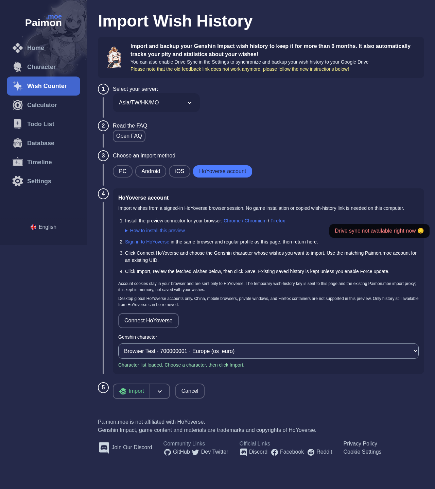
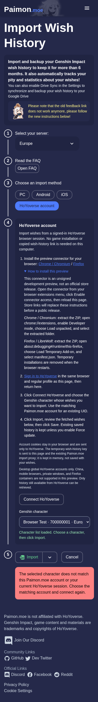
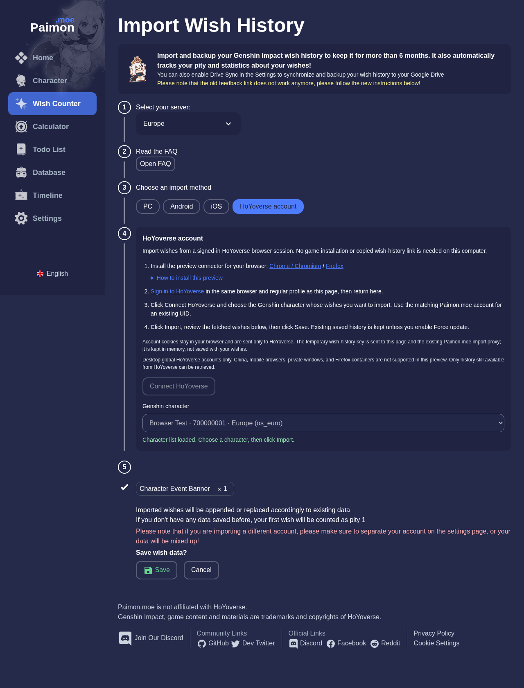

# HoYoverse browser-session wish import

**Wish Counter → Auto Import → HoYoverse account** imports wishes using a signed-in
HoYoverse desktop-browser session. The importing computer does not need the game
installed. The method shares the existing preview, explicit Save, force-update
backup, tally preference, and account/server model.

## Try the preview

Use Node.js 20+ and pnpm 10:

```sh
pnpm install --frozen-lockfile
# Set VITE_API_HOST in .env to your running Paimon.moe API.
npm run dev
```

Open <http://localhost:3000/wish/import> and select **HoYoverse account**. The page
includes installation instructions and downloads. Unpacked development builds
are also available in `browser-connector/dist-dev/chromium` and
`browser-connector/dist-dev/firefox`.

After installing, open the extension from the browser toolbar, select the site
address, and click **Enable connector access**. Keep the setup tab open while
answering the browser permission request, then reload the import page. Sign in
at <https://account.hoyoverse.com/> in the same regular browser profile, connect,
choose a character, and import. Review the preview before choosing **Save**.

Production packages accept `https://paimon.moe` and `https://www.paimon.moe`.
Development packages additionally accept `http://localhost:3000` and
`http://127.0.0.1:3000`. Other ports and LAN addresses are rejected at runtime.

The site uses the API host configured in `VITE_API_HOST`. The existing proxy
receives the temporary key and fetched history. Existing proxy/vault processing,
tally submission preferences, and local/Drive storage semantics are unchanged.
See [connector permissions and privacy](../browser-connector/README.md).

## Implementation

| Area                                 | Files and behavior                                                                                              |
| ------------------------------------ | --------------------------------------------------------------------------------------------------------------- |
| Instructions and character selection | `src/components/HoyoBrowserImport.svelte`; English locale keys with existing locale fallback                    |
| Existing importer                    | `src/routes/wish/import.svelte`; canonical temporary auth context feeds the same history/Save path              |
| Page bridge                          | `src/functions/hoyoverseBridge.js`; correlated, cancellable requests, validation, and teardown                  |
| Shared protocol                      | `src/functions/hoyoverseProtocol.js`; operation/version, payload size, role, and response checks                |
| Extension                            | `browser-connector/background.js`, `content.js`, `entry.js`; fixed HoYoverse operations and exact-origin checks |
| Permission setup                     | `browser-connector/setup.html`, `setup.js`; full tab keeps permission prompts visible                           |
| Packages                             | `browser-connector/build.mjs`; Node-only ZIP generation and separate production/development origins             |
| Navigation regression                | `src/routes/wish/index.svelte`; ignore late counter callbacks after the rank component unmounts                 |
| API                                  | No endpoint, schema, credential storage, or proxy behavior changes                                              |

Before key generation the page checks the saved UID; the background worker
fetches fresh roles and verifies that the selection still belongs to the current
session. The page checks the returned role and the UIDs of actual wish rows.
The selected global role determines the server/time-zone mapping.

Account cookies are attached by the browser only to fixed HoYoverse requests.
The extension does not read cookie values or persist credentials. The page and
existing import proxy receive the temporary authkey. The in-memory history URL
is released on completion, failure, cancellation, or route teardown; it is not
saved with wishes or exports. Auth-bearing URL logging is removed.

Manifest host patterns omit ports because Gecko does not match a port-bearing
localhost pattern to the corresponding page URL. The content script and
background worker independently enforce the exact origin, including port 3000.
A broader manifest pattern does not authorize other local ports.

## Verification

Start the dev server separately before browser tests:

```sh
npm run test:connector

# Install Playwright Chromium once, or set CHROMIUM_PATH to an installed binary.
pnpm exec playwright install chromium
npm run test:browser:connector
# Example: CHROMIUM_PATH=/usr/bin/chromium npm run test:browser:connector

# Optional native Firefox smoke test; install geckodriver separately.
npm run test:firefox:connector
# For LibreWolf, set FIREFOX_BINARY to the actual executable, not a shell wrapper.
# GECKODRIVER_PATH may point to a geckodriver executable outside PATH.

# Stop the dev server before building; both processes use .svelte-kit.
npm run build
npx web-ext lint --source-dir browser-connector/dist/firefox
```

Browser tests use disposable profiles and synthetic credentials/history. The
Chromium suite loads the actual unpacked extension and substitutes HoYoverse
responses in the worker and wish-history responses at the proxy boundary.
External page traffic, including advertising, analytics, Drive, and tally, is
blocked. The optional Firefox test substitutes a signed-out response only in its
temporary extension fixture and exercises the native page/content/background
handshake. It never reads the user's profile. Temporary profiles are removed.

The Chromium suite covers preview → Save, key-free exports, no-new-wishes
imports, UID mismatch before key generation, signed-out and missing-connector
states, SPA navigation, multiple characters, cancellation during authorization,
a failed banner without saving partial data, and URL import with force-update
backup. It also checks a 390px layout with expanded installation instructions.
Set `PAIMON_SCREENSHOTS` to an output directory to capture fixture-only screenshots.

### Validation scope

- Protocol/background/bridge suite: 21 tests.
- Chromium integration: actual unpacked extension with synthetic responses.
- Native LibreWolf 158: localhost injection and signed-out response, including the
  regression that originally prevented connector detection.
- Separate live Chromium check: an existing authorized session, role selection,
  key creation, and 1,004 matching-UID wish rows reaching the preview. The proxy
  boundary was intercepted locally and forwarded to the fixed HoYoverse endpoint;
  no live key or history was sent to the public Paimon.moe proxy. This does not
  establish fresh-login UI or production-proxy end-to-end coverage.
- Static/prerender build, Firefox package lint, formatting, and diff checks.

Synthetic tests, native browser detection, and live authentication are separate
evidence. Fresh login UI, signed/store installation, and a complete automated
Firefox import/Save flow remain release validation work.

## Screenshots

All screenshots use synthetic character and wish data.



<details>
<summary>Mobile instructions and import preview</summary>





</details>

## Release discussion

This is an unsigned development preview, not an official store extension. Global
accounts in regular desktop profiles are the initial scope. China, Safari/mobile,
private windows, and Firefox containers are unsupported. Unofficial HoYoverse
endpoints may change; existing import methods remain available.

Before public release, agree on extension ownership, repository location, browser
store/signing responsibility, privacy declarations, and update policy. Replace
development installation instructions with verified store links, then validate
fresh login, signed installation/upgrade, and permission revocation in supported
browser versions. A script already executing on the trusted page can access page
messages and the key; this design does not protect against compromised page code
or a compromised existing proxy.
